<p align="center">
  
</p>

# MAKE UP AI

**Tu imagen, nuestra inteligencia.** Aplicación móvil de colorimetría personal y asesoría de imagen, construida con **Flutter** y **Firebase**. A partir de una selfie, la app calcula la estación de color de la usuaria (primavera, verano, otoño o invierno), su subtono y su paleta de colores, y con ellos le recomienda maquillaje y vestuario.

Proyecto de la materia Programación Móvil, Universidad Popular del Cesar.

---

## Tabla de contenido

1. [El problema](#el-problema)
2. [Qué hace la app](#qué-hace-la-app)
3. [Cómo funciona la colorimetría](#cómo-funciona-la-colorimetría)
4. [Tecnologías](#tecnologías)
5. [Arquitectura](#arquitectura)
6. [Diagramas](#diagramas)
7. [Estructura del proyecto](#estructura-del-proyecto)
8. [Backend en Firebase](#backend-en-firebase)
9. [Privacidad y seguridad](#privacidad-y-seguridad)
10. [Puesta en marcha](#puesta-en-marcha)
11. [Simulador AR](#simulador-ar)
12. [Pruebas](#pruebas)
13. [Generar el APK](#generar-el-apk)
14. [Estado del proyecto](#estado-del-proyecto)
15. [Autores](#autores)

---

## El problema

Elegir qué colores de ropa y de maquillaje favorecen a cada persona suele depender de una asesoría de imagen presencial, que es costosa y poco accesible. Sin ese conocimiento, es común comprar prendas y productos que apagan el rostro, no combinan entre sí o no se vuelven a usar.

## Qué hace la app

Make Up AI pone esa asesoría en el teléfono:

- **Analiza la selfie** de la usuaria y determina su estación de color, subtono (cálido, frío o neutro), contraste e intensidad.
- **Muestra su paleta personal**: colores básicos y para destacar en ropa, tonos de labial, rubor, sombra y base, y los colores que conviene evitar.
- **Arma looks completos** (ropa y maquillaje) que combinan entre sí y con su colorimetría, en un tablero tipo Pinterest filtrable por ocasión.
- **Recomienda** maquillaje y prendas acordes con su paleta, con filtros por tipo y ocasión y detalle de cada ítem.
- **Simula** maquillaje con la cámara frontal en Android: looks recomendados por colorimetría y prueba libre, con varias categorías simultáneas que se mezclan con el tono real de la piel.
- **Responde dudas de estilo** con un asistente de IA que conoce su estación y subtono, y que siempre contesta (si Gemini falla, responde un asesor de respaldo).
- **Organiza el Armario personal**: guarda productos y prendas del catálogo, y consulta capturas del simulador. El escáner de prendas queda fuera del alcance.
- **Gestiona un catálogo** de prendas y productos mediante un panel de administración (solo rol admin).
- **Abre la plataforma a marcas de maquillaje**: la admin general crea marcas y asigna sus administradoras; cada marca carga o importa sus productos y ve un panel con sus estadísticas (calificaciones, "me gusta", vistas y pruebas en AR), siempre en totales anónimos.

Además incluye registro con verificación de correo, inicio de sesión con correo o Google, recuperación de contraseña, perfil editable con foto, notificaciones y eliminación de cuenta.

## Cómo funciona la colorimetría

```
Selfie ─► Detección de zona de piel ─► Análisis de color ─► Estación + subtono
                                                           + contraste + intensidad
                                                                  │
                                                                  ▼
                                      Paleta de la estación (ropa, maquillaje, evitar)
```

1. La usuaria acepta el **consentimiento biométrico** y toma una selfie guiada por un óvalo en pantalla.
2. La imagen se reduce y se analiza. El análisis puede hacerse **en el teléfono** o con **Cloud Functions**; la fuente se elige en un solo punto del código.
3. El resultado (estación, subtono, contraste, intensidad y nivel de confianza) se guarda en el perfil de la usuaria. **La foto no se conserva**: se borra al terminar el análisis.
4. La paleta correspondiente a la estación se muestra en la pantalla de paleta.

### Looks por colorimetría

El motor de looks (`lib/data/services/looks/motor_looks.dart`) corre en el teléfono y arma outfits completos con su maquillaje a partir del catálogo activo:

- Solo usa prendas y productos de la estación y el subtono de la usuaria.
- Une las prendas con una regla de armonía medida en CIELAB (tono h\*): **monocromático** (menos de 25°), **tonos vecinos** (hasta 90°), **complementario** (130° o más) o **básicos con un acento**. Los cruces de 90° a 130° chocan y se descartan.
- Ajusta el contraste claro/oscuro del outfit al contraste natural de la usuaria.
- Elige labial y rubor de la misma familia de color y coordinados con el color protagonista; la sombra acompaña el acento.
- La intensidad del labial depende de la ocasión (más suave para trabajo o entrevista, más intensa para fiesta o cita) y de la intensidad de la usuaria.
- No repite prendas ni nombres y alterna los productos de maquillaje entre looks.

## Tecnologías

| Área | Tecnología |
|---|---|
| App móvil | Flutter 3.44 (canal stable) y Dart 3.12 |
| Estado | `provider` (`ChangeNotifier`, `ProxyProvider`) |
| Autenticación | Firebase Auth (correo y contraseña, Google) |
| Base de datos | Cloud Firestore |
| Archivos | Firebase Storage |
| Lógica en la nube | Cloud Functions (Node 22, TypeScript, funciones *callable* v2) |
| Notificaciones | Firebase Cloud Messaging |
| Cámara y visión | `camera`, `google_mlkit_face_detection`, `google_mlkit_face_mesh_detection`, `image` |
| Capturas y compartir | `path_provider`, `share_plus` |
| Permisos y almacenamiento seguro | `permission_handler`, `flutter_secure_storage` |
| Selección de imágenes | `image_picker` |

Plataformas: Android (principal) y web. iOS tiene recursos de ícono y arranque, pero la configuración de Firebase para iOS no está completa.

## Arquitectura

La app usa una arquitectura **por capas, sin saltos**: cada capa solo habla con la siguiente.

```
View  →  ViewModel  →  Provider  →  Repository / Service  →  Firebase
```

| Capa | Responsabilidad | Ejemplo |
|---|---|---|
| **View** | Solo dibuja y reenvía eventos. Nunca importa Firebase. | `LoginView` |
| **ViewModel** | Lógica y estado de **una** pantalla (`ChangeNotifier`). | `AuthViewModel` |
| **Provider** | Estado **compartido** entre pantallas (sesión, usuaria, perfil, paleta). | `SesionProvider` |
| **Repository** | Único que accede a Firestore y a Firebase Auth. | `UsuariaRepository` |
| **Service** | Envuelve Storage, permisos, Cloud Functions, análisis y notificaciones. | `StorageService` |
| **Model** | Datos inmutables con `fromMap`, `toMap` y `copyWith`. | `Usuaria` |

### Decisiones de diseño

- **Un solo registro de providers.** Todos se declaran en `lib/providers/app_providers.dart`, agrupados por módulo.
- **Sesión unificada.** `SesionProvider` combina la sesión de Firebase Auth, el documento de la usuaria y su rol. Las pantallas leen de ahí, nunca de `FirebaseAuth` directamente. Los providers con datos de la usuaria usan el mixin `LimpiezaPorSesion`, de modo que **se vacían solos al cerrar sesión**.
- **Rutas protegidas.** `AppRouter` asigna a cada ruta un nivel de acceso (pública, correo sin verificar, autenticada, admin) y `GuardiaRuta` redirige automáticamente: sin sesión va a login, con correo sin verificar va a verificación, y las rutas de administración exigen rol `admin`.
- **Errores en español.** `FirebaseErrorMapper` traduce los errores de Auth, Firestore, Storage, Functions y Google a mensajes comprensibles; la interfaz nunca muestra códigos técnicos.
- **Textos y estilos centralizados.** Todos los textos están en `core/constants/app_strings.dart`, las rutas de imágenes en `app_assets.dart`, y colores, degradados y tipografías salen del tema (`core/theme`).
- **Estados de pantalla.** Cada pantalla cubre carga, vacío y error con reintento mediante widgets compartidos (`IndicadorCarga`, `EstadoVacio`, `MensajeError`).
- **Datos de ejemplo solo en pruebas.** Los servicios simulados (por ejemplo `ColorimetriaMockService`) viven en `test/`; la app siempre usa los datos reales.

### Arranque y sesión

```
Splash ─┬─ sin sesión ── onboarding (solo la primera vez) ── Login ⇄ Registro
        ├─ correo sin verificar ── Verificar correo ── Home
        └─ sesión verificada ── Home
```

Al tocar el ícono, Android muestra el arranque nativo con el logo y su brillo sobre fondo morado (Android 12 o superior solo admite un ícono centrado; en versiones anteriores se ve la imagen completa). Ese arranque se mantiene hasta que el splash animado tiene sus imágenes listas (`FlutterNativeSplash.preserve`), y el primer cuadro de Flutter es idéntico a él: el logo crece y se desplaza hasta su lugar mientras aparece la imagen de marca, sin cortes.

El splash dura 6 segundos y decide el destino con `SplashViewModel`. Al terminar la animación espera a Firebase como máximo 8 segundos más; si no responde, o falla la lectura de la sesión, lleva a login con un aviso claro en lugar de quedarse esperando. El paso a la siguiente pantalla es un fundido de 1,2 segundos.

En toda la app, el indicador de carga es el rostro del logo latiendo (`LogoCargando`). Home se muestra apenas llegan el perfil y la paleta; las recomendaciones cargan después, en paralelo, con tarjetas de espera.

## Diagramas

Los diagramas están en Mermaid: GitHub los dibuja directamente.

### Arquitectura general

Las flechas hacia Firebase salen siempre de repositorios o servicios, nunca de la interfaz. Lo que necesita secretos o confianza (IA, borrar cuentas, notificaciones) corre en Cloud Functions.

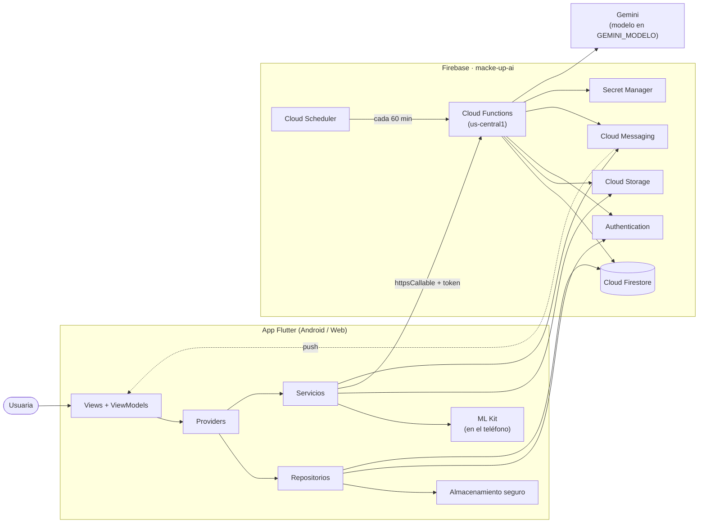

### Capas

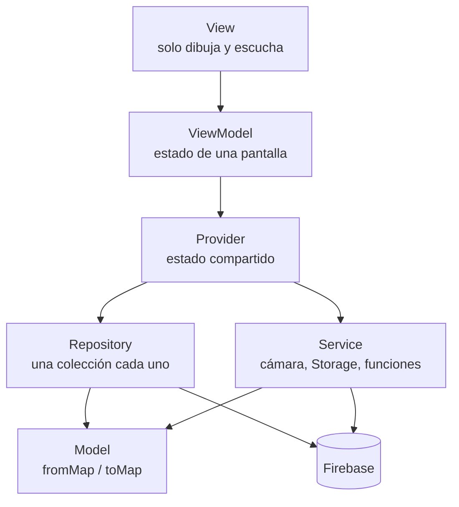

### Conexión con Firebase y sesión

`Firebase.initializeApp` usa `firebase_options.dart`. Al iniciar sesión, Firebase Auth entrega un token con el uid que viaja en cada petición; las reglas (`request.auth.uid`) y las funciones (`exigirSesion`) lo verifican.

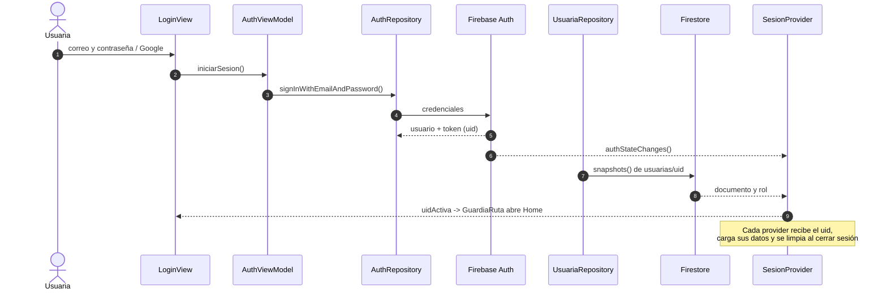

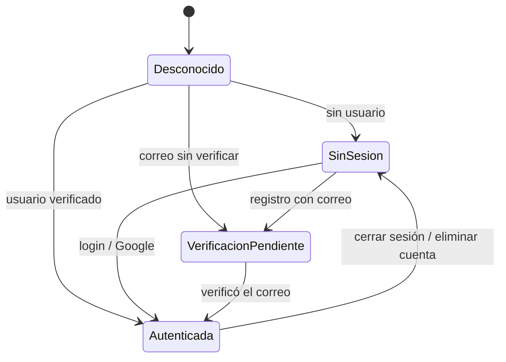

### Análisis de colorimetría

La selfie se analiza en el teléfono y nunca sale del dispositivo; solo el resultado se guarda.

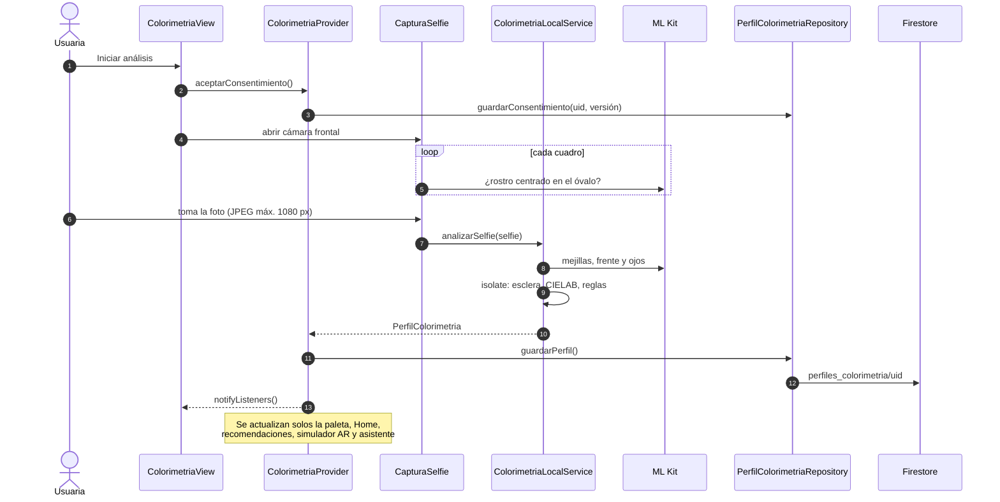

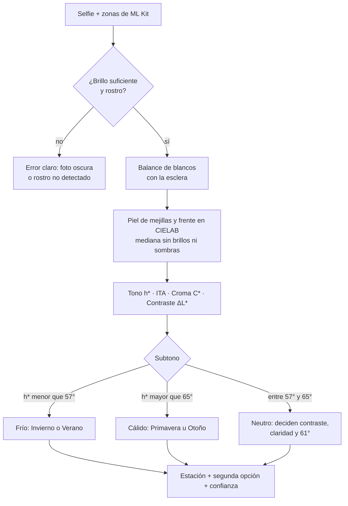

### Recomendaciones

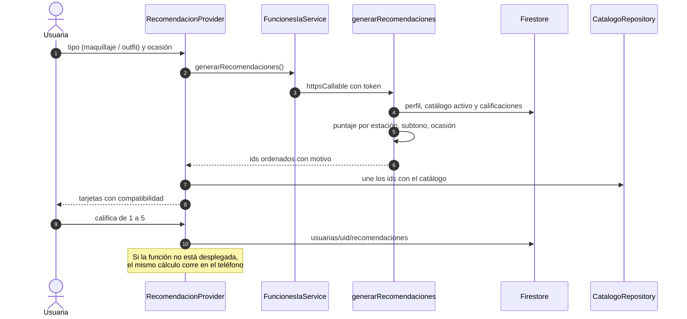

### Asistente de IA

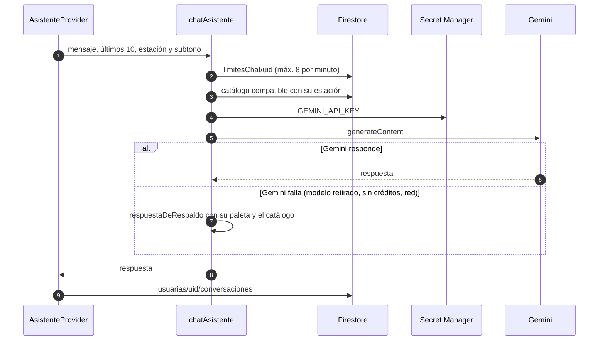

El modelo se configura con `GEMINI_MODELO` en `functions/.env` (hoy `gemini-3.8-flash`).

### Eliminar cuenta

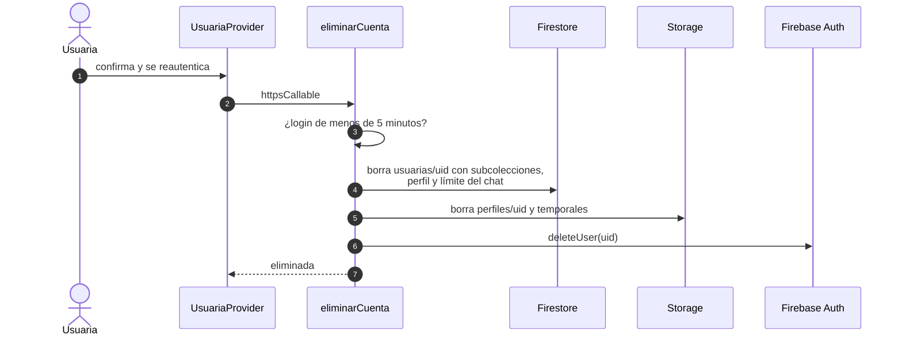

### Publicación de las Cloud Functions

Se publican con `firebase deploy --only functions --project macke-up-ai` (plan Blaze). La clave de Gemini se guarda una sola vez con `firebase functions:secrets:set GEMINI_API_KEY`; lo que no es secreto va en `functions/.env`.

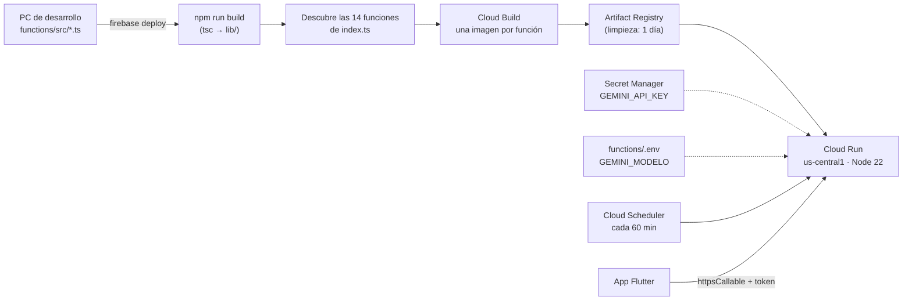

Si el CLI tarda en cargar las funciones ("Timeout after 10000"), se le da más tiempo con `FUNCTIONS_DISCOVERY_TIMEOUT=30` antes del comando. Para comprobar lo publicado: `firebase functions:list --project macke-up-ai`.

### Modelo de datos (Firestore)

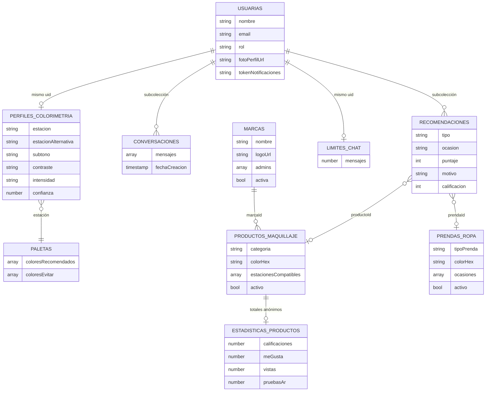

## Estructura del proyecto

```
lib/
├── main.dart, app.dart, firebase_options.dart
├── core/
│   ├── constants/    app_strings, app_constants, app_assets
│   ├── errors/       app_exception, firebase_error_mapper
│   ├── extensions/   contexto, fechas, etiquetas de enums
│   ├── routes/       app_routes, app_router, guardia_ruta
│   ├── theme/        colores, degradados, estilos de texto, tema
│   ├── utils/        validadores, formateadores, color, imagen, snackbar
│   └── widgets/      botones, campos, tarjeta, avatar, estados, paleta…
├── models/           usuaria, sesion, credencial, perfil de colorimetría,
│                     paleta, producto de maquillaje, prenda, recomendación…
├── data/
│   ├── repositories/ auth, usuaria, sesion, credencial, perfil de colorimetría,
│   │                 paleta, catálogo, recomendaciones, conversaciones
│   ├── services/     storage, permisos, cloud functions, análisis de color y
│   │                 de prendas, notificaciones, eliminación de cuenta, marcas,
│   │                 detección facial AR, tonos de piel y labios (tonos_rostro_ar)
│   │   └── looks/    motor de looks por colorimetría
│   └── datos/        paletas por estación y catálogo de ejemplo
├── providers/        app_providers, auth, usuaria, sesión, colorimetría,
│                     paleta, notificaciones
└── ui/
    ├── splash/       arranque animado, onboarding con ilustraciones
    ├── auth/         login, registro, verificación, recuperación, privacidad
    ├── home/         inicio y navegación inferior
    ├── perfil/       perfil, edición y eliminación de cuenta
    ├── colorimetria/ selfie, análisis, resultado, paleta y looks para ti
    ├── recomendaciones/ recomendaciones, filtros y detalle
    ├── asistente/    chat con el asistente de IA
    ├── simulador_ar/ cámara, modos, capas y renderizado de maquillaje
    ├── armario/      productos guardados y capturas del simulador
    ├── admin/        catálogo de prendas y productos
    ├── marcas/       marcas, panel "Mi marca" e importación de productos
    └── dashboard/    panel de la admin general

functions/            Cloud Functions (TypeScript)
assets/images/        logo, rostro del logo y splash (WebP)
assets/icon/          imágenes fuente del ícono y de la pantalla de arranque
auditoria/            auditoría de seguridad (amenazas, OWASP, hallazgos, scripts)
test/                 pruebas automatizadas
```

Cada pantalla vive en su carpeta con el par `*_view.dart` y `*_view_model.dart`, y los componentes propios en `widgets/`.

## Backend en Firebase

Proyecto de Firebase: `macke-up-ai`.

**Firestore** (colecciones principales):

| Colección | Contenido |
|---|---|
| `usuarias` | Datos de la usuaria, rol (`usuaria` o `admin`), consentimientos y token de notificaciones |
| `perfiles_colorimetria` | Resultado del análisis de cada usuaria |
| `paletas` | Paleta de colores por estación |
| `prendasRopa` y `productosMaquillaje` | Catálogo de prendas (46 de ejemplo) y productos (54 de ejemplo), con la marca de cada producto |
| `marcas` | Marcas de maquillaje y sus administradoras |
| `estadisticasProductos` | Totales anónimos por producto (solo los escriben las funciones) |

El catálogo de ejemplo se carga desde la app con **Catálogo → Cargar catálogo de ejemplo** (cuenta admin) o con `npm run sembrar:catalogo` dentro de `functions/`.

**Storage:**

- `perfiles/{uid}/foto.jpg`: foto de perfil.
- `temporales/selfies/{uid}/{id}.jpg`: selfies en análisis; se eliminan al terminar o, como máximo, en una hora.

**Cloud Functions** (región `us-central1`, detalle en [functions/README.md](functions/README.md)):

| Función | Qué hace |
|---|---|
| `analizarSelfie` | Analiza la selfie subida a Storage y la borra al terminar |
| `generarPaleta` | Devuelve la paleta de una estación |
| `limpiarImagenesTemporales` | Tarea programada que elimina imágenes temporales vencidas |
| `analizarPrenda` | Compara el color de una prenda con la paleta de la usuaria |
| `generarRecomendaciones` | Genera recomendaciones de maquillaje y vestuario a partir del perfil y el catálogo |
| `chatAsistente` | Respuestas del asistente de IA, con respaldo si Gemini falla |
| `eliminarCuenta` | Elimina la cuenta y los datos de la usuaria |
| `enviarNotificacion` | Envía notificaciones push |
| `asignarAdminMarca` | La admin general da o quita a una cuenta el permiso de administrar una marca |
| `alCalificarProducto` y `alMarcarMeGusta` | Actualizan las estadísticas del producto cuando una usuaria lo califica o le da "me gusta" |
| `registrarEvento` | Cuenta vistas del detalle y pruebas en AR (una por usuaria y producto) |
| `resumenMarca` y `resumenAdmin` | Datos de los paneles de cada marca y de la admin general |

## Privacidad y seguridad

- **Consentimiento explícito.** El registro exige aceptar el aviso de privacidad, y la colorimetría exige un consentimiento biométrico aparte. Ambos guardan la versión aceptada y la fecha.
- **La selfie no se conserva.** Solo se guarda el resultado del análisis.
- **"Recordarme" guarda únicamente el correo**, en almacenamiento seguro del dispositivo. Nunca la contraseña.
- **Roles.** El rol de la usuaria no puede modificarse desde la app; las rutas y funciones de administración exigen rol `admin`.
- **Derecho al olvido.** La usuaria puede eliminar su cuenta desde Perfil, tras reautenticarse (contraseña o Google).
- **Sin secretos en el código.** Las claves que aparecen en `firebase_options.dart` son identificadores públicos de cliente de Firebase; la seguridad real depende de las reglas de Firestore y Storage (`firestore.rules` y `storage.rules`).
- **Pantallas protegidas.** La selfie, el simulador AR y sus capturas activan `FLAG_SECURE`: Android bloquea capturas y grabaciones de pantalla y oculta la vista previa en apps recientes.
- **Certificate pinning.** `network_security_config.xml` prohíbe el tráfico sin cifrar y fija las conexiones a Google (`*.googleapis.com`, `*.cloudfunctions.net`) a sus autoridades raíz, con fecha de renovación y un script para verificarlas (`auditoria/scripts/verificar_pines.ps1`).
- **Marcas sin datos personales.** Las marcas solo ven totales. Las estadísticas identifican a cada usuaria con un código (hash), nunca con su uid, correo o nombre, y su aporte se resta si borra su calificación, su "me gusta" o su cuenta.
- **Auditoría.** La carpeta `auditoria/` documenta el modelo de amenazas, la revisión OWASP Top 10, los hallazgos, su verificación y el análisis con MobSF antes y después.

## Puesta en marcha

**Requisitos:** Flutter 3.44 (stable) y Dart 3.12, Android Studio con el SDK de Android, y Node 22 solo si se van a trabajar las Cloud Functions.

```bash
git clone https://github.com/Karquin06/ProjectMake-UpAi.git
cd ProjectMake-UpAi
flutter pub get
flutter run
```

- **Windows:** activa el *Modo de desarrollador* (`start ms-settings:developers`); los plugins de Flutter lo necesitan para compilar.
- **Firebase:** la configuración de cliente está en `lib/firebase_options.dart` y `android/app/google-services.json`. En la consola de Firebase deben estar habilitados Authentication (correo/contraseña y Google), Firestore y Storage.
- **Inicio de sesión con Google en Android:** la app firma en modo debug con `android/app/debug.keystore`, compartido por el equipo, cuya huella SHA ya está registrada en Firebase. Si alguien tenía instalada una versión firmada con otra clave, debe desinstalarla una vez.
- **Cloud Functions:** desde `functions/`, `npm install`, `npm test` y `npm run deploy` (requiere plan Blaze y `firebase login`).

### Banderas de desarrollo (`app_constants.dart`)

| Bandera | Efecto |
|---|---|
| `usarMockEliminarCuenta` | Simula la eliminación completa de la cuenta en el cliente |
| `usarMockStorage` | La foto de perfil no se sube a Storage |
| `armarioHabilitado` | Muestra el acceso al Armario en Home |

## Simulador AR

El simulador permite probar maquillaje del catálogo sobre la imagen de la cámara frontal. Se integra con el perfil de colorimetría, las recomendaciones y el Armario de la usuaria.

### Modalidades

- **Looks para mí:** combina productos reales recomendados según la estación y el subtono del perfil de colorimetría. Cada look se juzga completo: labial y rubor de la misma familia de color, un solo foco intenso (labios u ojos, nunca los dos) y descarte de las combinaciones que chocan. Las combinaciones dependen de los productos disponibles en el catálogo.
- **Prueba libre:** permite explorar productos compatibles del catálogo, incluidos los no recomendados para el perfil personal.

### Maquillaje por capas

- Aplica labial, rubor y sombra simultáneamente.
- Permite sustituir o quitar un producto y ajustar su intensidad sin retirar los demás.
- Incluye comparación con la imagen original y limpieza de todas las capas.
- Permite capturar el resultado, guardarlo por cuenta en el dispositivo, consultarlo desde el Armario y abrir el diálogo del sistema para compartirlo.

Ambas modalidades utilizan una sola cámara y el mismo motor de capas. El renderizado se mantiene separado de la selección de productos y las recomendaciones.

### Cómo se ve realista

La vista previa de la cámara es una textura nativa: el maquillaje no puede mezclarse con ella mediante modos de fusión y se pinta encima. Para que no parezca una calcomanía:

- **Mezcla con el tono real.** En cada detección se mide, en el propio cuadro de la cámara (YUV), el color promedio de los labios y de las mejillas (`tonos_rostro_ar.dart`). Cada producto se pinta ya mezclado con ese tono, como un "multiplicar": labial al 55 %, rubor al 75 % y base al 50 %. Así tiñe la piel en vez de taparla: un labial claro sobre labios oscuros se ve profundo y no pálido.
- **Labial:** color pleno en el centro que se difumina hacia el contorno y lo cruza un poco, con un sombreado más oscuro hacia el borde exterior de cada labio. Con la boca cerrada los dos labios se unen en la línea media, hasta las comisuras reales; con la boca abierta no se pintan los dientes.
- **Rubor:** mancha redonda en la manzana del pómulo, ubicada con los puntos del pómulo de la malla facial, con un degradado amplio y suave.
- **Sombra:** en el párpado, difuminada, con un tono más profundo en la esquina exterior del ojo.
- **Base:** cubre el centro del rostro y se desvanece hacia la frente, la mandíbula y alrededor de los ojos, sin bordes marcados.

### Seguimiento facial

- Arranca con **ML Kit Face Mesh** (468 puntos), que sigue mejor la forma de los labios y ubica el pómulo. Si es lenta (más de 200 ms tres veces seguidas) o no entrega los labios, pasa sola a **Face Detection** (contornos).
- Un filtro One Euro suaviza los puntos y una predicción corta compensa el retraso del detector.
- Para que el maquillaje no parpadee con el look completo, se aceptan detecciones de hasta 400 ms y la última geometría válida se conserva hasta 600 ms.
- El botón de rendimiento (arriba a la derecha) muestra los puntos detectados y el detector activo.

### Uso

1. Inicia sesión y abre **Simulador AR**. Concede el permiso de cámara.
2. Selecciona un look en **Looks para mí** si ya tienes un análisis de colorimetría, o elige productos en **Prueba libre**.
3. Ajusta las capas, cambia productos y compara el resultado con la imagen original.
4. Captura el resultado y consúltalo desde **Armario → Mis pruebas de maquillaje**.

### Compatibilidad y alcance

El maquillaje AR está orientado a Android y se probó en un Samsung Galaxy A32. Con poca luz los colores se ven más tenues, igual que en la realidad. La versión web ofrece vista previa de cámara, catálogo, selección de looks y Armario; no aplica maquillaje sobre el vídeo.

Cejas y brillo tienen representaciones aproximadas cuando existen esos productos en el catálogo. Delineador, pestañina, corrector, iluminador y contorno todavía no tienen efectos implementados. La simulación es una referencia visual: no reproduce con fidelidad física la cobertura, textura o acabado de cada producto.

## Pruebas

```bash
flutter analyze
flutter test
```

La suite (330 pruebas) cubre modelos, validadores, widgets, rutas y guardias, autenticación, splash, Home, Perfil, colorimetría y motor de looks, catálogo, marcas, asistente, pantallas protegidas y el simulador AR (geometría, mezcla con el tono real, boca cerrada, armonía de looks y seguimiento). La prueba `test/integracion/flujo_completo_test.dart` arranca la app real con Firebase simulado y recorre registro, verificación de correo, Home, edición de perfil, cierre de sesión, login y eliminación de cuenta.

Las Cloud Functions se prueban con `npm test` dentro de `functions/`.

## Generar el APK

```bash
flutter build apk --release --split-per-abi --obfuscate --split-debug-info=build/symbols --tree-shake-icons
```

O, en Windows, `.\auditoria\scripts\construir_apk.ps1 -PorArquitectura`, que corre ese comando, deja los APK en `dist/` como `MakeUpAI-<versión>-<arquitectura>.apk`, guarda una copia de `build/symbols` en `Documentos\MakeUpAI-simbolos\<versión>_<commit>` y verifica la firma.

- **Un APK por procesador** (`--split-per-abi`): `arm64-v8a` sirve para casi todos los teléfonos actuales, `armeabi-v7a` para los antiguos de 32 bits y `x86_64` para emuladores.
- **Código ofuscado** (`--obfuscate`): los nombres de clases y funciones de Dart no se pueden leer en el APK. Los símbolos para interpretar los errores quedan en `build/symbols`; **guarden esa carpeta por cada versión publicada**, porque `flutter clean` la borra y sin ella no se pueden leer los stack traces.
- **Sin lo que no se usa:** R8 elimina el código y los recursos Android sin uso (`isMinifyEnabled` e `isShrinkResources` en `android/app/build.gradle.kts`), `--tree-shake-icons` deja solo los íconos de Material que la app usa y las imágenes van en WebP (`node auditoria/scripts/imagenes_webp.mjs` convierte las nuevas).
- **Firma:** el release se firma con la llave de publicación del equipo (`android/key.properties` y `android/app/llave-release.jks`, fuera del repositorio). Sin ella la compilación de release se detiene con un aviso, en lugar de firmar con la clave de depuración.

La compilación necesita varios GB libres en disco. Antes de entregar, prueben el APK instalado en un teléfono real.

## Estado del proyecto

| Módulo | Estado |
|---|---|
| Autenticación (registro, verificación, login con correo o Google, recuperación, privacidad) | Disponible |
| Arranque nativo con el logo, splash animado, onboarding e ícono | Disponible |
| Home y navegación | Disponible |
| Perfil (datos, colorimetría, foto, cierre de sesión, eliminación de cuenta) | Disponible |
| Colorimetría, paleta y looks para ti | Disponible |
| Recomendaciones personalizadas (lista, filtros y detalle de prendas y productos) | Disponible |
| Asistente de IA | Disponible, con respuesta de respaldo si Gemini falla |
| Simulador AR | Disponible: looks armónicos, prueba libre, base, labial, rubor y sombra mezclados con el tono real, captura y compartir |
| Armario | Disponible: productos y prendas guardados, resultados y capturas privadas por cuenta |
| Catálogo de administración (prendas y productos) | Disponible |
| Marcas y paneles (admin general, "Mi marca", importación de productos) | Disponible |
| Seguridad (FLAG_SECURE, certificate pinning, auditoría) | Disponible |

**Limitaciones conocidas:**

- Las reglas de Firestore y Storage (`firestore.rules`, `storage.rules`) se publican aparte con `firebase deploy --only firestore:rules,storage --project macke-up-ai`; cada cambio en ellas hay que publicarlo.
- La configuración de Firebase para iOS no está completa.
- El simulador AR depende de la luz y del rendimiento del teléfono; con poca luz el maquillaje se ve tenue.

## Autores

Proyecto desarrollado por un equipo de cuatro integrantes:

- **Karlos Quintero**: base de la app (core, autenticación, home, perfil y splash).
- **Jaider Monrroy**: colorimetría, paleta, looks por colorimetría y servicios compartidos.
- **Ana Cuellar**: recomendaciones, asistente de IA, catálogo, marcas y paneles.
- **Mauricio Parra**: simulador AR y armario.
