<p align="center">
  
</p>

# MAKE UP AI

**Tu imagen, nuestra inteligencia.** Aplicación móvil de colorimetría personal y asesoría de imagen, construida con **Flutter** y **Firebase**. A partir de una selfie, la app calcula la estación de color de la usuaria (primavera, verano, otoño o invierno), su subtono y su paleta de colores, y con ellos le recomienda maquillaje y vestuario.

Proyecto de la materia Programación Móvil, Universidad Popular del Cesar.

---

## Tabla de contenido

1. [El problema](#el-problema)
2. [Qué hace la app](#qué-hace-la-app)
3. [Cómo funciona la colorimetría](#cómo-funciona-la-colorimetría)
4. [Tecnologías](#tecnologías)
5. [Arquitectura](#arquitectura)
6. [Diagramas](#diagramas)
7. [Estructura del proyecto](#estructura-del-proyecto)
8. [Backend en Firebase](#backend-en-firebase)
9. [Privacidad y seguridad](#privacidad-y-seguridad)
10. [Puesta en marcha](#puesta-en-marcha)
11. [Simulador AR](#simulador-ar)
12. [Pruebas](#pruebas)
13. [Generar el APK](#generar-el-apk)
14. [Estado del proyecto](#estado-del-proyecto)
15. [Autores](#autores)

---

## El problema

Elegir qué colores de ropa y de maquillaje favorecen a cada persona suele depender de una asesoría de imagen presencial, que es costosa y poco accesible. Sin ese conocimiento, es común comprar prendas y productos que apagan el rostro, no combinan entre sí o no se vuelven a usar.

## Qué hace la app

Make Up AI pone esa asesoría en el teléfono:

- **Analiza la selfie** de la usuaria y determina su estación de color, subtono (cálido, frío o neutro), contraste e intensidad.
- **Muestra su paleta personal**: colores básicos y para destacar en ropa, tonos de labial, rubor, sombra y base, y los colores que conviene evitar.
- **Recomienda** maquillaje y prendas acordes con su paleta, con filtros por tipo y ocasión y detalle de cada ítem.
- **Simula** maquillaje con la cámara frontal en Android: looks recomendados por colorimetría y prueba libre, con varias categorías simultáneas.
- **Organiza el Armario personal**: guarda productos y prendas del catálogo, y consulta capturas del simulador. El escáner de prendas queda fuera del alcance.
- **Gestiona un catálogo** de prendas y productos mediante un panel de administración (solo rol admin).

Además incluye registro con verificación de correo, inicio de sesión con correo o Google, recuperación de contraseña, perfil editable con foto, notificaciones y eliminación de cuenta.

## Cómo funciona la colorimetría

```
Selfie ─► Detección de zona de piel ─► Análisis de color ─► Estación + subtono
                                                           + contraste + intensidad
                                                                  │
                                                                  ▼
                                      Paleta de la estación (ropa, maquillaje, evitar)
```

1. La usuaria acepta el **consentimiento biométrico** y toma una selfie guiada por un óvalo en pantalla.
2. La imagen se reduce y se analiza. El análisis puede hacerse **en el teléfono** o con **Cloud Functions**; la fuente se elige en un solo punto del código.
3. El resultado (estación, subtono, contraste, intensidad y nivel de confianza) se guarda en el perfil de la usuaria. **La foto no se conserva**: se borra al terminar el análisis.
4. La paleta correspondiente a la estación se muestra en la pantalla de paleta.

## Tecnologías

| Área | Tecnología |
|---|---|
| App móvil | Flutter 3.44 (canal stable) y Dart 3.12 |
| Estado | `provider` (`ChangeNotifier`, `ProxyProvider`) |
| Autenticación | Firebase Auth (correo y contraseña, Google) |
| Base de datos | Cloud Firestore |
| Archivos | Firebase Storage |
| Lógica en la nube | Cloud Functions (Node 22, TypeScript, funciones *callable* v2) |
| Notificaciones | Firebase Cloud Messaging |
| Cámara y visión | `camera`, `google_mlkit_face_detection`, `google_mlkit_face_mesh_detection`, `image` |
| Capturas y compartir | `path_provider`, `share_plus` |
| Permisos y almacenamiento seguro | `permission_handler`, `flutter_secure_storage` |
| Selección de imágenes | `image_picker` |

Plataformas: Android (principal) y web. iOS tiene recursos de ícono y arranque, pero la configuración de Firebase para iOS no está completa.

## Arquitectura

La app usa una arquitectura **por capas, sin saltos**: cada capa solo habla con la siguiente.

```
View  →  ViewModel  →  Provider  →  Repository / Service  →  Firebase
```

| Capa | Responsabilidad | Ejemplo |
|---|---|---|
| **View** | Solo dibuja y reenvía eventos. Nunca importa Firebase. | `LoginView` |
| **ViewModel** | Lógica y estado de **una** pantalla (`ChangeNotifier`). | `AuthViewModel` |
| **Provider** | Estado **compartido** entre pantallas (sesión, usuaria, perfil, paleta). | `SesionProvider` |
| **Repository** | Único que accede a Firestore y a Firebase Auth. | `UsuariaRepository` |
| **Service** | Envuelve Storage, permisos, Cloud Functions, análisis y notificaciones. | `StorageService` |
| **Model** | Datos inmutables con `fromMap`, `toMap` y `copyWith`. | `Usuaria` |

### Decisiones de diseño

- **Un solo registro de providers.** Todos se declaran en `lib/providers/app_providers.dart`, agrupados por módulo.
- **Sesión unificada.** `SesionProvider` combina la sesión de Firebase Auth, el documento de la usuaria y su rol. Las pantallas leen de ahí, nunca de `FirebaseAuth` directamente. Los providers con datos de la usuaria usan el mixin `LimpiezaPorSesion`, de modo que **se vacían solos al cerrar sesión**.
- **Rutas protegidas.** `AppRouter` asigna a cada ruta un nivel de acceso (pública, correo sin verificar, autenticada, admin) y `GuardiaRuta` redirige automáticamente: sin sesión va a login, con correo sin verificar va a verificación, y las rutas de administración exigen rol `admin`.
- **Errores en español.** `FirebaseErrorMapper` traduce los errores de Auth, Firestore, Storage, Functions y Google a mensajes comprensibles; la interfaz nunca muestra códigos técnicos.
- **Textos y estilos centralizados.** Todos los textos están en `core/constants/app_strings.dart`, las rutas de imágenes en `app_assets.dart`, y colores, degradados y tipografías salen del tema (`core/theme`).
- **Estados de pantalla.** Cada pantalla cubre carga, vacío y error con reintento mediante widgets compartidos (`IndicadorCarga`, `EstadoVacio`, `MensajeError`).
- **Datos de ejemplo solo en pruebas.** Los servicios simulados (por ejemplo `ColorimetriaMockService`) viven en `test/`; la app siempre usa los datos reales.

### Arranque y sesión

```
Splash ─┬─ sin sesión ── onboarding (solo la primera vez) ── Login ⇄ Registro
        ├─ correo sin verificar ── Verificar correo ── Home
        └─ sesión verificada ── Home
```

El splash muestra el logo animado y decide el destino con `SplashViewModel`. Si Firebase no responde en 8 segundos, o falla la lectura de la sesión, lleva a login con un aviso claro en lugar de quedarse esperando.

## Diagramas

Los diagramas están en Mermaid: GitHub los dibuja directamente.

### Arquitectura general

Las flechas hacia Firebase salen siempre de repositorios o servicios, nunca de la interfaz. Lo que necesita secretos o confianza (IA, borrar cuentas, notificaciones) corre en Cloud Functions.

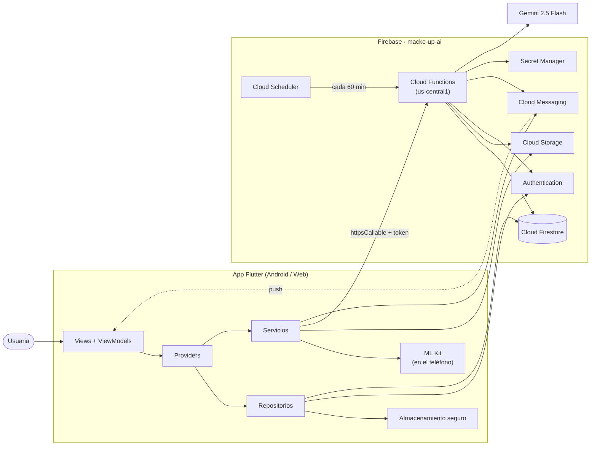

### Capas

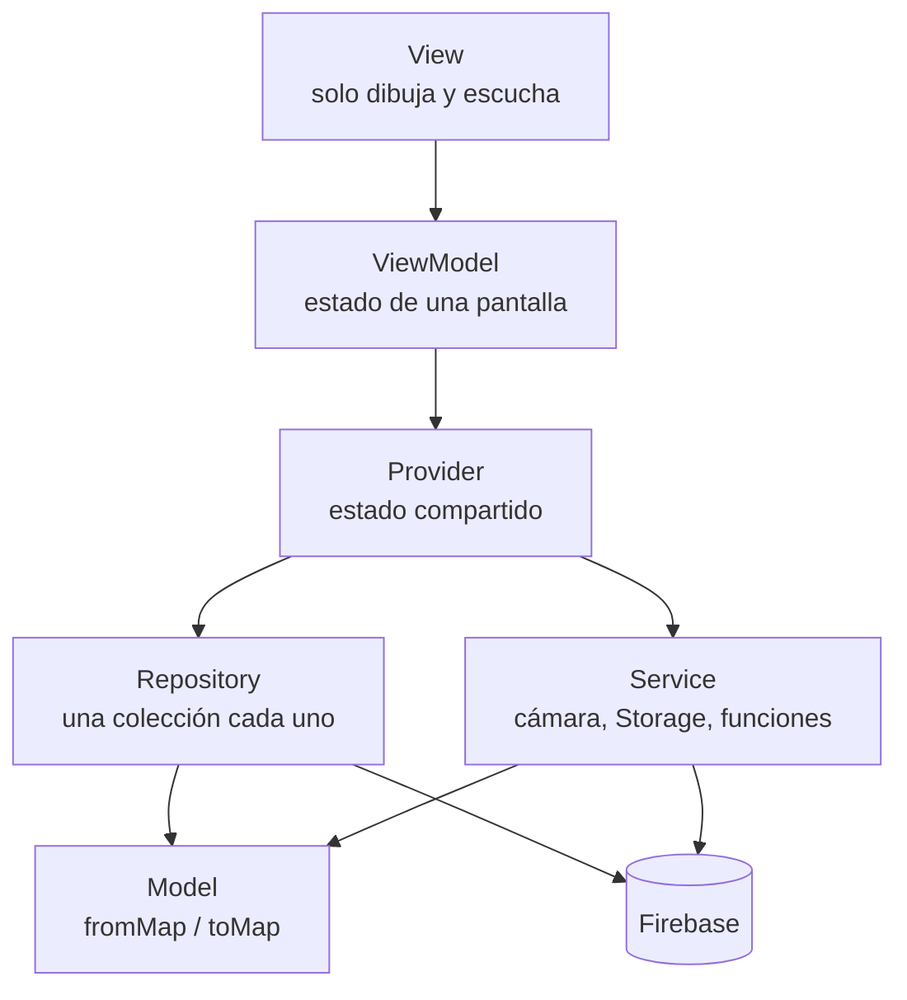

### Conexión con Firebase y sesión

`Firebase.initializeApp` usa `firebase_options.dart`. Al iniciar sesión, Firebase Auth entrega un token con el uid que viaja en cada petición; las reglas (`request.auth.uid`) y las funciones (`exigirSesion`) lo verifican.

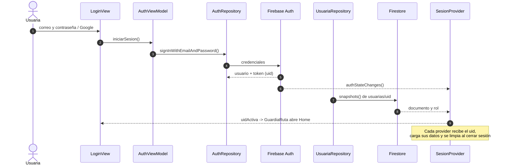

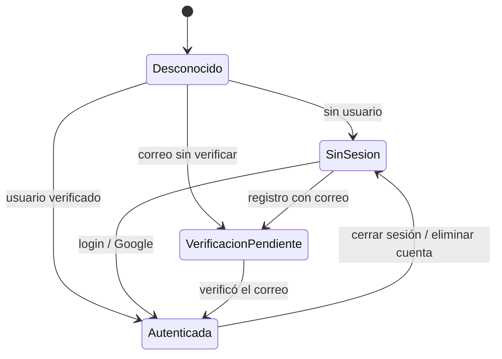

### Análisis de colorimetría

La selfie se analiza en el teléfono y nunca sale del dispositivo; solo el resultado se guarda.

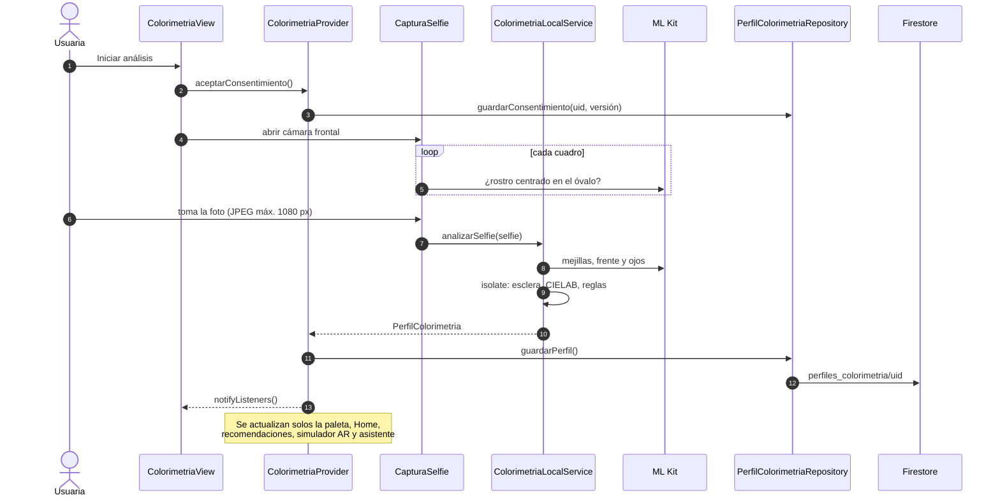

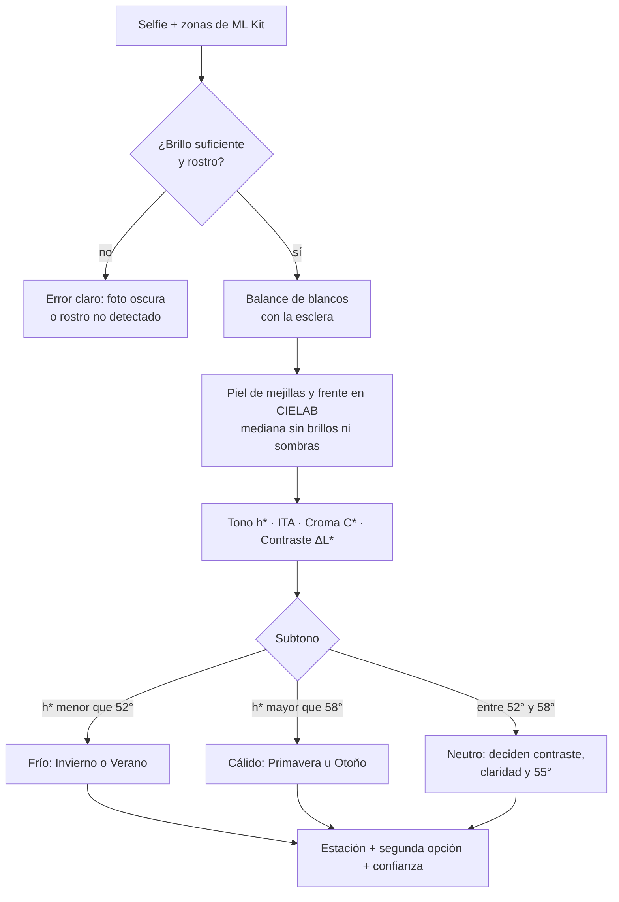

### Recomendaciones

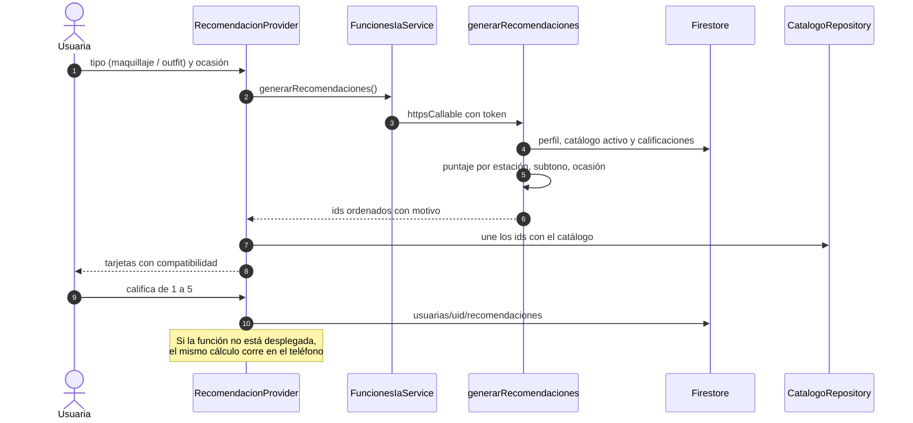

### Asistente de IA

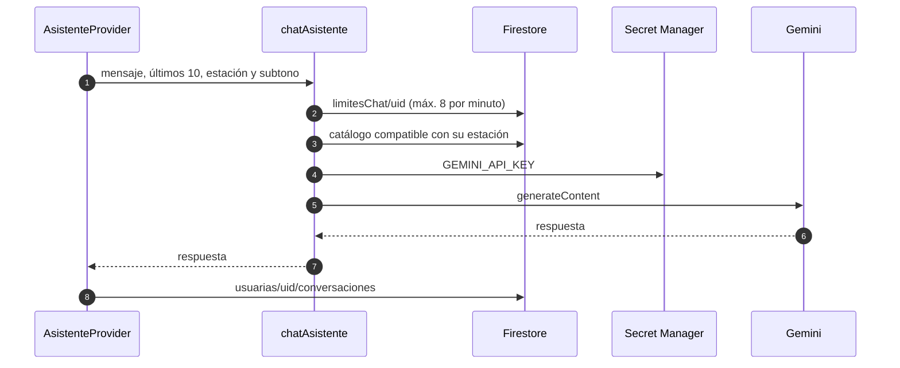

### Eliminar cuenta

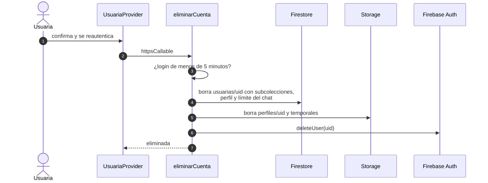

### Publicación de las Cloud Functions

Se publican con `firebase deploy --only functions --project macke-up-ai` (plan Blaze). La clave de Gemini se guarda una sola vez con `firebase functions:secrets:set GEMINI_API_KEY`; lo que no es secreto va en `functions/.env`.

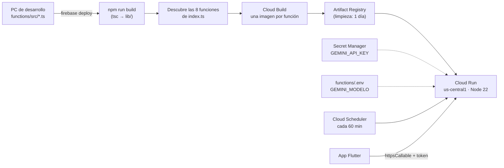

Si el CLI tarda en cargar las funciones ("Timeout after 10000"), se le da más tiempo con `FUNCTIONS_DISCOVERY_TIMEOUT=30` antes del comando. Para comprobar lo publicado: `firebase functions:list --project macke-up-ai`.

### Modelo de datos (Firestore)

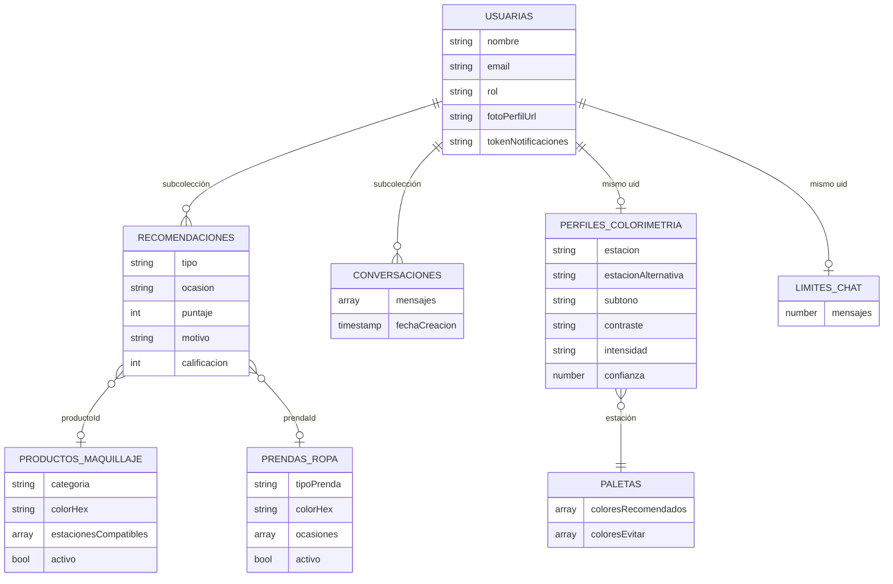

## Estructura del proyecto

```
lib/
├── main.dart, app.dart, firebase_options.dart
├── core/
│   ├── constants/    app_strings, app_constants, app_assets
│   ├── errors/       app_exception, firebase_error_mapper
│   ├── extensions/   contexto, fechas, etiquetas de enums
│   ├── routes/       app_routes, app_router, guardia_ruta
│   ├── theme/        colores, degradados, estilos de texto, tema
│   ├── utils/        validadores, formateadores, color, imagen, snackbar
│   └── widgets/      botones, campos, tarjeta, avatar, estados, paleta…
├── models/           usuaria, sesion, credencial, perfil de colorimetría,
│                     paleta, producto de maquillaje, prenda, recomendación…
├── data/
│   ├── repositories/ auth, usuaria, sesion, credencial, perfil de colorimetría,
│   │                 paleta, catálogo, recomendaciones, conversaciones
│   ├── services/     storage, permisos, cloud functions, análisis de color y
│   │                 de prendas, notificaciones, eliminación de cuenta
│   └── datos/        paletas por estación y catálogo de ejemplo
├── providers/        app_providers, auth, usuaria, sesión, colorimetría,
│                     paleta, notificaciones
└── ui/
    ├── splash/       logo animado y onboarding
    ├── auth/         login, registro, verificación, recuperación, privacidad
    ├── home/         inicio y navegación inferior
    ├── perfil/       perfil, edición y eliminación de cuenta
    ├── colorimetria/ selfie, análisis, resultado y paleta
    ├── recomendaciones/ recomendaciones, filtros y detalle
    ├── simulador_ar/ cámara, modos, capas y renderizado de maquillaje
    └── admin/        catálogo de prendas y productos

functions/            Cloud Functions (TypeScript)
assets/images/        logo del proyecto
assets/icon/          imágenes fuente del ícono y de la pantalla de arranque
test/                 pruebas automatizadas
```

Cada pantalla vive en su carpeta con el par `*_view.dart` y `*_view_model.dart`, y los componentes propios en `widgets/`.

## Backend en Firebase

Proyecto de Firebase: `macke-up-ai`.

**Firestore** (colecciones principales):

| Colección | Contenido |
|---|---|
| `usuarias` | Datos de la usuaria, rol (`usuaria` o `admin`), consentimientos y token de notificaciones |
| `perfiles_colorimetria` | Resultado del análisis de cada usuaria |
| `paletas` | Paleta de colores por estación |
| `prendasRopa` y `productosMaquillaje` | Catálogo de prendas y productos |

**Storage:**

- `perfiles/{uid}/foto.jpg`: foto de perfil.
- `temporales/selfies/{uid}/{id}.jpg`: selfies en análisis; se eliminan al terminar o, como máximo, en una hora.

**Cloud Functions** (región `us-central1`, detalle en [functions/README.md](functions/README.md)):

| Función | Qué hace |
|---|---|
| `analizarSelfie` | Analiza la selfie subida a Storage y la borra al terminar |
| `generarPaleta` | Devuelve la paleta de una estación |
| `limpiarImagenesTemporales` | Tarea programada que elimina imágenes temporales vencidas |
| `analizarPrenda` | Compara el color de una prenda con la paleta de la usuaria |
| `generarRecomendaciones` | Genera recomendaciones de maquillaje y vestuario a partir del perfil y el catálogo |
| `chatAsistente` | Respuestas del asistente de IA |
| `eliminarCuenta` | Elimina la cuenta y los datos de la usuaria |
| `enviarNotificacion` | Envía notificaciones push |

## Privacidad y seguridad

- **Consentimiento explícito.** El registro exige aceptar el aviso de privacidad, y la colorimetría exige un consentimiento biométrico aparte. Ambos guardan la versión aceptada y la fecha.
- **La selfie no se conserva.** Solo se guarda el resultado del análisis.
- **"Recordarme" guarda únicamente el correo**, en almacenamiento seguro del dispositivo. Nunca la contraseña.
- **Roles.** El rol de la usuaria no puede modificarse desde la app; las rutas y funciones de administración exigen rol `admin`.
- **Derecho al olvido.** La usuaria puede eliminar su cuenta desde Perfil, tras reautenticarse (contraseña o Google).
- **Sin secretos en el código.** Las claves que aparecen en `firebase_options.dart` son identificadores públicos de cliente de Firebase; la seguridad real depende de las reglas de Firestore y Storage.

## Puesta en marcha

**Requisitos:** Flutter 3.44 (stable) y Dart 3.12, Android Studio con el SDK de Android, y Node 22 solo si se van a trabajar las Cloud Functions.

```bash
git clone https://github.com/Karquin06/ProjectMake-UpAi.git
cd ProjectMake-UpAi
flutter pub get
flutter run
```

- **Windows:** activa el *Modo de desarrollador* (`start ms-settings:developers`); los plugins de Flutter lo necesitan para compilar.
- **Firebase:** la configuración de cliente está en `lib/firebase_options.dart` y `android/app/google-services.json`. En la consola de Firebase deben estar habilitados Authentication (correo/contraseña y Google), Firestore y Storage.
- **Inicio de sesión con Google en Android:** la app firma en modo debug con `android/app/debug.keystore`, compartido por el equipo, cuya huella SHA ya está registrada en Firebase. Si alguien tenía instalada una versión firmada con otra clave, debe desinstalarla una vez.
- **Cloud Functions:** desde `functions/`, `npm install`, `npm test` y `npm run deploy` (requiere plan Blaze y `firebase login`).

### Banderas de desarrollo (`app_constants.dart`)

| Bandera | Efecto |
|---|---|
| `usarMockEliminarCuenta` | Simula la eliminación completa de la cuenta en el cliente |
| `usarMockStorage` | La foto de perfil no se sube a Storage |
| `armarioHabilitado` | Muestra el acceso al Armario en Home |

## Simulador AR

La documentación del módulo se centraliza en este README. Estado al **28 de octubre de 2026**, con entrega prevista el **29 de octubre de 2026**. El escáner de prendas queda fuera del alcance; no se elimina código heredado de otros módulos que pueda seguir en uso.

### Diagnóstico y diseño

#### Diagnóstico anterior a la ampliación

Los siguientes párrafos describen el punto de partida de la revisión; la funcionalidad actual se detalla más adelante.

Existe una sola sesión de cámara frontal, permiso, control de ciclo de vida, conversión YUV420/NV21 probada en Samsung, rotación y espejo. ML Kit Face Detection devuelve únicamente cuatro curvas de labios al modelo AR. Un CustomPainter pinta un único labial semitransparente. El repintado utiliza ValueNotifier y solo se conserva el último fotograma pendiente. Web permite vista previa sin reconocimiento.

MaquillajeArViewModel mantiene un producto y una intensidad global; ProductoProvider filtra por estación y la vista solo ofrece labiales. No hay estado de looks ni mezcla de categorías. RecomendacionProvider ya une recomendaciones con productos activos de Firestore y calcula un respaldo local con datos reales del catálogo cuando la función no está desplegada. ColorimetriaProvider conserva el perfil real. Se reutilizarán esos contratos; no se generarán productos de ejemplo en producción.

El catálogo declara cuatro categorías (labial, rubor, sombra, base), colorHex, tono y acabado. No contiene texturas, rugosidad, cobertura, pigmentación medida ni máscaras por producto. Hay captura PNG privada por cuenta, pero no compartir ni una descripción de todas las capas en la captura. El rendimiento del prototipo ampliado requiere una nueva medición física en Samsung.

#### Evaluación técnica

| Tecnología | Ventajas para este proyecto | Coste / limitación | Decisión |
|---|---|---|---|
| ML Kit Face Detection | Ya integrado, contornos 2D y conversión comprobada; alternativa sin migrar cámara | Geometría escasa; la versión anterior tuvo retraso; no habilitar tracking ID junto con contornos | Conservar como alternativa funcional |
| ML Kit Face Mesh | 468 puntos 3D, misma entrada InputImage, SDK Android 23+, modelo empaquetado; adecuado para efectos de selfie | Beta, sin soporte web; rendimiento Samsung no medido; adaptador Flutter comunitario | Principal Android del prototipo, con alternativa ante fallo del SDK |
| MediaPipe Face Landmarker | 478 puntos, seguimiento temporal, suavizado con un rostro, matrices y blendshapes; mejor base futura para expresiones y otras plataformas | Otro modelo y canal nativo/GPU que requiere integración y validación adicionales | Interfaz de detector sustituible; migración posterior, sin prometer integración completada |

Las cifras de latencia publicadas por Google corresponden a sus dispositivos y no equivalen a FPS del Samsung. La aceptación de >=20 FPS queda sujeta a medición física en profile.

Fuentes consultadas:

- https://developers.google.com/ml-kit/vision/face-detection/android
- https://developers.google.com/ml-kit/vision/face-mesh-detection
- https://developers.google.com/ml-kit/vision/face-mesh-detection/android
- https://developers.google.com/edge/mediapipe/solutions/vision/face_landmarker/android
- https://pub.dev/packages/google_mlkit_face_mesh_detection (adaptador, no mantenido por Google)
- https://pub.dev/packages/share_plus

#### Arquitectura del motor por capas

~~~mermaid
flowchart LR
  PERFIL[ColorimetriaProvider] --> REC[RecomendacionProvider existente]
  CAT[ProductoProvider / catálogo real] --> VM[MaquillajeArViewModel]
  REC --> LOOKS[Compositor de looks]
  LOOKS --> VM
  VM --> CAPAS[Mapa de capas por categoría]
  CAM[Una CameraController] --> DET[Detector sustituible Mesh / Detection]
  DET --> GEO[Regiones faciales y coordenadas]
  GEO --> RENDER[Pintor común de capas]
  CAPAS --> RENDER
  RENDER --> CAPTURA[Captura privada y compartir voluntario]
~~~

Reconocimiento, geometría, composición de looks, selección y renderizado son piezas separadas. El cambio entre recomendado y libre no crea otra cámara. La lista de capas y sus ajustes son inmutables; cambiar o quitar una categoría conserva las otras. El orden de renderizado no depende del orden de selección.

Los looks son combinaciones deterministas de las recomendaciones reales por categoría, filtradas por compatibilidad de estación/subtono. Se muestran como Combinación 1, 2, etc., sin inventar recomendaciones semánticas de fiesta o noche. Si faltan categorías, se indica que el look es parcial; si no hay datos, se muestra vacío y reintento. El modo libre usa todos los productos activos con color válido, incluidos los no recomendados, y conserva ambos modos sobre el mismo motor.

#### Plan priorizado

1. Estado por capas y compositor: catálogo real, modo recomendado/libre, cambios y borrado individual, limpieza total, invalidación al cambiar sesión/perfil. Pruebas con Firestore falso y datos exclusivamente de prueba.
2. Geometría: adaptador Face Mesh y alternativa Detection ampliada a ojos, cejas, mejillas y óvalo; conservar NV21 y transformaciones comprobadas. Pérdida del rostro y resultados antiguos no deben dejar maquillaje pegado a una posición.
3. Renderizado: labial + rubor + sombra simultáneos, máscaras por región, exclusión de ojos/boca, bordes difuminados, mezcla y límites de opacidad. Brillo/cejas y base solo como aproximaciones declaradas si se habilitan; delineador, pestañina, corrector, iluminador y contorno quedan en el registro extensible sin fingir realismo ni aplicar efectos no implementados.
4. UI: looks, selector por categoría, lista de capas con nombre/producto/tono, intensidad y acabado visual cuando exista, quitar capa, limpiar y comparar original. Captura y compartir con todas las capas.
5. Verificación: pruebas de no invención de datos, composición y edición, sesión/perfil, espejo/rotación/escala, máscaras fuera de regiones, exclusión de ojos/boca, expiración, métricas. flutter analyze, flutter test y APK profile arm64. Medición Samsung de >=30 s tras calentamiento: FPS de procesamiento válidos, p50/p95 y tiempo de pintado; reportar el resultado real, aunque sea inferior a 20.

#### Evolución compatible del catálogo

No se modifican documentos ni reglas de Firestore automáticamente. Propuesta: campo opcional visualAr={version:1, motor, opacidadInicial, cobertura, suavizadoRelativo, acabadosDisponibles, rugosidad, texturaUrl}. La ausencia de parámetros usa límites conservadores del prototipo y se informa como aproximación. Texturas y parámetros de delineador/pestañas requieren activos y validación; el actual colorHex no basta para afirmar fidelidad del producto. Nuevas categorías necesitarán coordinación con administración, validadores y reglas; el registro AR ya puede reservarlas sin reconstruir la pantalla.

#### Criterio de salida

Una cuenta con análisis y recomendaciones multiclase puede aplicar un look de productos reales, observar las categorías soportadas a la vez y sustituir una sin alterar las demás. En libre puede elegir un producto de otra estación. Si no existe esa información real, se presenta su ausencia. Las capturas se hacen solo por acción del usuario; compartir abre el diálogo del sistema y nunca envía automáticamente a terceros. La calidad visual, la captura de la textura de cámara y los FPS requieren confirmación en el Samsung.

### Funcionalidad, verificación y demostración

#### Resultado implementado

| Función | Estado del prototipo |
|---|---|
| Looks personales | Se consume RecomendacionProvider y se une con el catálogo activo actual. Se filtra la estación y el subtono cuando está especificado. Las combinaciones son deterministas y solo contienen productos que realmente existen. |
| Datos insuficientes | Look parcial o vacío. No se inyectan mocks ni se completan categorías con productos inventados. Un fallo de carga permite reintentar o cambiar a libre. |
| Prueba libre | Todos los productos activos con tono válido; permite elegir productos de otras estaciones. Las categorías sin renderizador se muestran como no implementadas. |
| Aplicación simultánea | Mapa de capas por categoría, con orden fijo. Un look se aplica de forma atómica; sustituir, quitar o ajustar una capa conserva el resto. |
| Labial, rubor y sombra | Máscaras dinámicas con bordes suaves y transparencia. Se protege la abertura de la boca y el interior de los ojos. El rubor y la sombra se recortan al óvalo facial. |
| Base, cejas y brillo | Representaciones aproximadas, disponibles únicamente si el catálogo contiene esos productos. Base es un velo de color, no cobertura ni reconstrucción real de piel. Cejas es un tinte y brillo una variación visual sencilla. |
| Delineador, pestañina, corrector, iluminador, contorno | Reservados en el registro extensible; no se aplican ni se presentan como realistas. Requieren parámetros/activos y renderizadores específicos. |
| Reconocimiento | Face Mesh principal en Android; Face Detection alternativo solo ante fallo del SDK. Ambos producen el mismo modelo de regiones. La pérdida de rostro no cambia artificialmente de motor. |
| Transformaciones | Rotación de la entrada del detector y proyección orientada sobre el mismo CameraPreview; espejo frontal una sola vez y escala al lienzo sin recorte independiente. |
| Cámara | Una sola CameraController para los dos modos y todas las capas. No se abre otra al cambiar look, categoría o intensidad. |
| Capturas | PNG privado por cuenta con descripción de productos y metadatos de todas las capas (id, categoría, tono, HEX, intensidad, acabado y original). Compatibilidad con capturas antiguas conservada. |
| Compartir | Acción explícita tras capturar o desde Mis pruebas de maquillaje. Abre el diálogo del sistema mediante share_plus; no envía nada automáticamente. |
| Web | Conserva vista previa de webcam, selección, looks y Armario. La detección, maquillaje sobre vídeo y captura AR de este motor siguen siendo Android. |

Los colores se componen con srcOver para mezclar transparencia de forma predecible sobre CameraPreview. No se afirma que multiply o color modifiquen los píxeles de la cámara desde una capa transparente separada. Los degradados y el difuminado son recursos visuales aproximados, no una medición física del acabado de cada producto.

#### Archivos principales

- lib/models/maquillaje_ar.dart: capas, looks, registro de categorías y candidatos inmutables.
- lib/data/services/compositor_looks_ar.dart: composición sin acceso a Firebase ni dependencia de providers.
- lib/ui/simulador_ar/maquillaje_ar_view_model.dart: catálogo, perfil/recomendaciones, modos y edición individual.
- lib/data/services/malla_facial_ar_service.dart: adaptador de Face Mesh y alternativa de detección.
- lib/models/deteccion_facial_ar.dart: regiones faciales comunes, malla y transformaciones.
- lib/ui/simulador_ar/motor/geometria_maquillaje_ar.dart: construcción y recorte de máscaras.
- lib/ui/simulador_ar/widgets/pintor_maquillaje_ar.dart: renderizado común de todas las capas.
- lib/ui/simulador_ar/simulador_ar_view_model.dart: cámara, último fotograma pendiente, caducidad y métricas.
- lib/data/services/compartir_ar_service.dart: diálogo de compartir.

Para añadir otro producto que utilice una región existente basta registrar su categoría y definición. Para una región nueva se añade su generador de máscara y estilo; no hay que reconstruir la cámara, los modos ni el selector. Las categorías globales de administración y sus reglas deben evolucionar con el equipo: el registro de AR no cambia automáticamente el esquema del catálogo.

#### Parámetros faltantes en el catálogo

Actualmente se usan colorHex y acabado, junto con opacidad conservadora por categoría. El campo visualAr propuesto anteriormente es una **propuesta de evolución**, no un campo ya implementado ni leído por este prototipo. Para incorporarlo habría que extender fromMap, toMap, copyWith, formularios y validadores sin perder compatibilidad. No se modificaron documentos ni reglas de Firestore.

#### Verificación automática

- Primera etapa: pruebas de composición sin inventar datos y edición independiente de tres capas.
- Segunda etapa: pruebas de exclusión de ojos/boca, movimiento, escala, espejo y pintura conjunta comprobada por píxeles.
- Contrato del adaptador: conversión de formato, rotación, regiones y profundidad desde el canal simulado de Face Mesh; alternativa ante fallo del SDK y ausencia de cambio de motor cuando no hay rostro. Estas pruebas no sustituyen ejecutar el SDK en un teléfono.
- Interfaz a 360 px: elegir un look de tres productos, quitar una sombra y cambiar el labial por uno no recomendado sin quitar el rubor.
- Captura y sesión: registra todas las capas, compartir exige otra acción y una cuenta distinta no conserva la última captura de la anterior.
- Integridad: un perfil nuevo durante una carga descarta la respuesta vieja y recarga candidatos compatibles; productos desaparecidos del catálogo no se fabrican.
- Seguimiento: resultados de más de 200 ms desde la llegada al proceso Dart se descartan; si no llega otro resultado útil, las coordenadas caducan tras 250 ms.
- Suite completa final: **214 pruebas aprobadas**.
- flutter analyze: sin problemas en la última comprobación.
- Compilación Android ARM64 profile: aprobada. APK: build/app/outputs/flutter-apk/app-profile.apk (104,6 MB).
- Compilación web release: aprobada, salida build/web. Mantiene vista previa sin maquillaje AR.
- Ambas compilaciones finalizaron con código 0; no equivalen a una prueba visual en el Samsung.

#### Recorrido de demostración

1. Inicia sesión con una cuenta que tenga análisis de colorimetría y productos activos en el catálogo. Un análisis guardado debe pertenecer al uid de la cuenta actual.
2. Abre Simulador AR. En Looks para mí selecciona Combinación 1. Para demostrar tres productos, las recomendaciones reales deben contener al menos labial, rubor y sombra compatibles; si falta algo, se indicará que es parcial.
3. Comprueba las capas aplicadas y sus nombres/tonos. Toca la capa Rubor y ajusta su intensidad. El labial y la sombra deben conservarse.
4. Borra la sombra desde su capa. Cambia a Prueba libre, elige Labial y selecciona otro tono, incluso de otra estación. El rubor debe permanecer.
5. Compara Ver original / Ver maquillaje. Quitar todo debe retirar todas las capas.
6. Con el rostro detectado y maquillaje aplicado, captura. Consulta el resultado desde Armario → Mis pruebas de maquillaje. Compartir debe abrir el diálogo del sistema; solo se comparte si el usuario elige un destino.
7. Cambia la orientación, sal y regresa a la app. Comprueba alineación, ausencia de cámara duplicada y recuperación. Oculta el rostro para verificar que los efectos desaparecen.

#### Medición pendiente en Samsung

**No hay una medición de FPS nueva ni una validación visual física de este prototipo.** La calidad de ajuste, oclusiones, captura de la textura de cámara y compartir requieren esa prueba.

1. Conecta el Samsung SM-A325M, desbloquéalo y comprueba flutter devices.
2. Ejecuta `flutter run --profile -d <id-del-dispositivo>` desde la carpeta del proyecto. No evalúes velocidad con debug.
3. Aplica labial + rubor + sombra. Espera al menos 8 segundos para completar calentamiento y primera ventana.
4. Abre el icono de velocímetro. Durante 30 segundos mantén el rostro visible y haz movimientos suaves, después giros y gestos habituales. Repite con buena luz y una escena más exigente.
5. Registra motor, entrada de fotogramas, detecciones procesadas/s, detecciones válidas/s, p50/p95 de procesamiento y coste CPU del pintor. La meta es >=20 detecciones válidas/s de forma sostenida, junto con una superposición visual estable; que la cámara solicite 30 fps no demuestra esa meta.
6. Comprueba la calidad observando el vídeo y una captura. El tiempo CPU de pintura no es tiempo GPU ni latencia total de sensor a pantalla. La edad medida parte de la llegada a Dart: no existe timestamp del sensor expuesto por este flujo.
7. Registra los valores reales, aunque estén por debajo de la meta. Si no se alcanza: medir primero el coste de la serialización de malla (el adaptador transfiere triángulos que este renderizador no utiliza), conversión y detector antes de introducir otro motor o reducir resolución por debajo de las recomendaciones del SDK.

| Escenario | Detecciones válidas/s | p50 | p95 | Pintura CPU | Calidad visual |
|---|---|---|---|---|---|
| Labial + rubor + sombra | Sin medir | Sin medir | Sin medir | Sin medir | Pendiente en Samsung |
| Movimiento y giro | Sin medir | Sin medir | Sin medir | Sin medir | Pendiente en Samsung |

#### Límites de entrega

Este es un prototipo 2D guiado por regiones de una malla facial, no un motor de maquillaje físicamente realista equivalente a TikTok o Instagram. No utiliza texturas específicas de cada producto ni segmentación de cabello/manos. El motor solo muestra una cara prominente. Face Mesh y su adaptador Flutter requieren Android y el SDK sigue en beta. La interfaz conserva estados vacíos, errores y reintento; no presenta datos de prueba como recomendaciones personales.

## Pruebas

```bash
flutter analyze
flutter test
```

La suite cubre modelos, validadores, widgets, rutas y guardias, autenticación, splash, Home, Perfil, colorimetría, catálogo y el simulador AR. La prueba `test/integracion/flujo_completo_test.dart` arranca la app real con Firebase simulado y recorre registro, verificación de correo, Home, edición de perfil, cierre de sesión, login y eliminación de cuenta.

Las Cloud Functions se prueban con `npm test` dentro de `functions/`.

## Generar el APK

```bash
flutter build apk --release --split-per-abi
```

El archivo recomendado queda en `build/app/outputs/flutter-apk/app-arm64-v8a-release.apk` (sirve para casi todos los teléfonos Android actuales). La compilación necesita varios GB libres en disco. El APK de release usa la clave de depuración, por lo que sirve para pruebas y entregas, no para publicar en Play Store.

## Estado del proyecto

| Módulo | Estado |
|---|---|
| Autenticación (registro, verificación, login, recuperación, privacidad) | Disponible |
| Splash con logo animado, onboarding, ícono y pantalla de arranque | Disponible |
| Home y navegación | Disponible (la estación usa datos de ejemplo hasta activar el perfil real de colorimetría) |
| Perfil (edición, foto, cierre de sesión, eliminación de cuenta) | Disponible (foto y eliminación completa con modo simulado hasta desplegar la función) |
| Colorimetría y paleta | Disponible |
| Catálogo de administración (prendas y productos) | Disponible |
| Simulador AR | Prototipo por capas: looks, prueba libre, labial/rubor/sombra, captura y compartir; validación visual y rendimiento en Samsung pendientes |
| Recomendaciones personalizadas (lista, filtros y detalle de prendas y productos) | Disponible |
| Asistente de IA | En desarrollo (función en la nube y repositorio listos; pantalla pendiente) |
| Armario | Disponible: productos y prendas guardados, resultados y capturas privadas por cuenta |

**Limitaciones conocidas:**

- Las reglas de seguridad de Firestore y Storage deben revisarse y publicarse en el proyecto `macke-up-ai`.
- La configuración de Firebase para iOS no está completa.

## Autores

Proyecto desarrollado por un equipo de cuatro integrantes:

- **Karlos Quintero**: base de la app (core, autenticación, home, perfil y splash).
- **Jaider Monrroy**: colorimetría, paleta y servicios compartidos.
- **Ana Cuellar**: recomendaciones, asistente de IA y catálogo.
- **Mauricio Parra**: simulador AR y armario.
