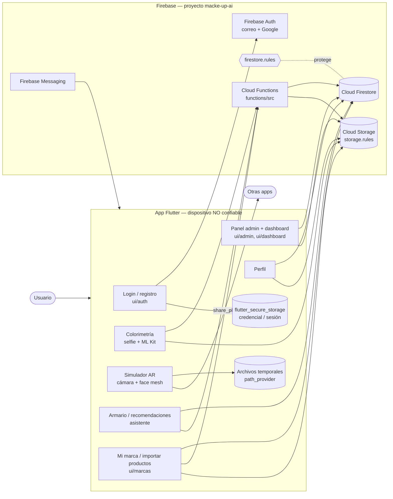

# Fase 1 — Modelo de amenazas

## 1. Diagrama de la app

Punto de partida con los componentes que hay hoy en el código. Ajustar flechas y pantallas
según lo que el grupo revise.

## 2. Datos sensibles

| Dato | Dónde se genera | Dónde se guarda | En tránsito por | Sensibilidad |
|---|---|---|---|---|
| Correo y contraseña | Login | Firebase Auth (¿y en el dispositivo?) | HTTPS a Auth | Alta |
| Token de sesión / ID token | Firebase Auth | ¿`flutter_secure_storage`? ¿memoria? | Cabeceras a Functions | Alta |
| Selfie / rostro | Cámara | Storage / temporales | HTTPS a Storage y Functions | Alta (biométrico) |
| Tono de piel / colorimetría | Functions | Firestore | HTTPS | Media |
| Fotos de prendas | Galería / cámara | Storage | HTTPS | Media |
| Rol de administrador | Custom claims | Token de Auth | — | Alta |
| Rol de dueño de marca y sus productos | Admin / `marcas.ts` | Firestore | HTTPS | Alta |
| Token FCM | Messaging | Firestore | HTTPS | Baja |
| _completar…_ | | | | |

## 3. Amenazas (mínimo tres)

| ID | Amenaza | Quién la aprovecharía | Activo afectado | Riesgo OWASP | Control esperado |
|---|---|---|---|---|---|
| A-01 | Distribuir un APK modificado (por ejemplo, con robo de credenciales) firmado con la misma llave que la app real, aprovechando que la llave está en el repositorio público | Cualquier persona que clone el repo | Cuentas de las usuarias, reputación de la app | M1, M8 | Llave de release privada y fuera del repo; rotar la llave expuesta (H-01) |
| A-02 | Una marca desactivada, o una admin de marca a la que se le quitó el rol, sigue modificando o borrando productos del catálogo | Ex-administradora de una marca | Catálogo de productos, recomendaciones que ven todas las usuarias | M3 | Reglas que revisen que la marca esté activa y revocación de sesión al cambiar el rol (H-03) |
| A-03 | Alguien con acceso al respaldo de Google o al teléfono (transferencia o copia de seguridad) recupera las fotos del rostro tomadas en el simulador AR | Persona con acceso a la cuenta de Google o al dispositivo | Fotos del rostro (dato biométrico) | M9, M6 | Excluir del respaldo y cifrar las capturas (H-02) |
| A-04 | Un script usa la configuración pública de Firebase para llamar a las Cloud Functions sin la app, agotando la cuota de Gemini o generando eventos falsos en las estadísticas de marcas | Atacante externo con cuentas creadas en masa | Costos del proyecto, métricas de marcas | M3 | App Check con Play Integrity y llaves de API restringidas (H-06) |

**Ya mitigadas en el diseño actual:** una usuaria que modifica la app para entrar al panel admin
no logra nada, porque reglas y Functions validan el claim `admin` en el servidor. Leer datos de
otras usuarias lo impiden las reglas por dueña.
